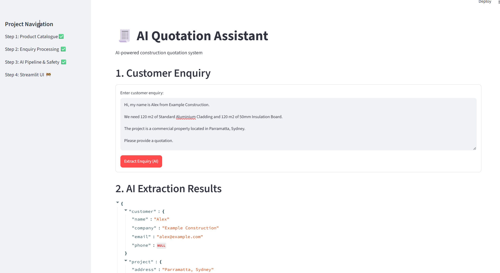
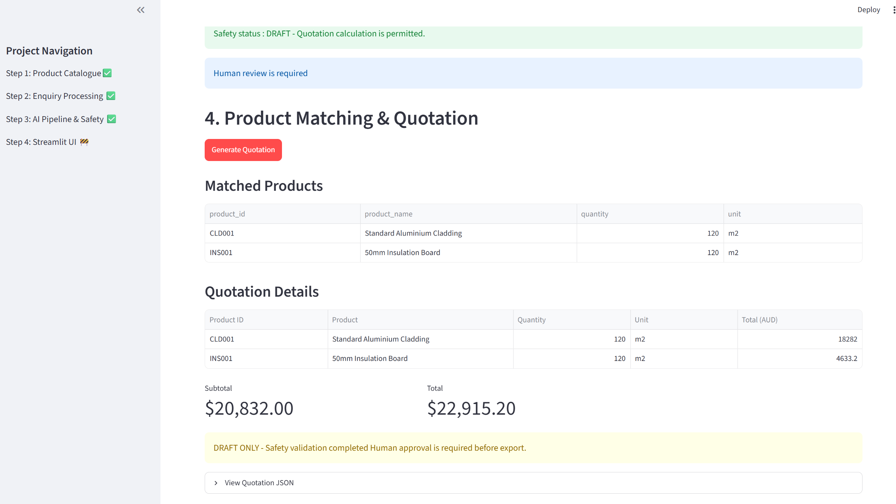
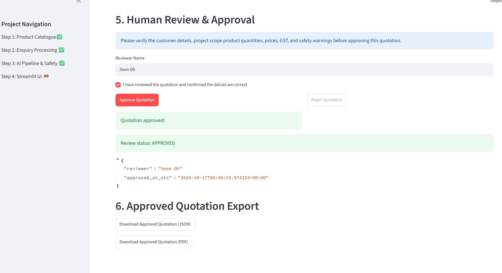

# AI Quotation Assistant

**An AI-assisted construction quotation prototype that transforms customer enquiries into structured, reviewable quotations.**

Built with **Python, Google Gemini, Pydantic, pandas, Streamlit, and ReportLab**. The language model extracts information from unstructured text, while catalogue matching, price calculation, and safety checks run in Python. A reviewer must approve a draft before JSON and PDF export are available.

> **Project status:** Portfolio MVP / demonstration. Uses a synthetic product catalogue. Not intended for unattended production quoting or customer delivery without further validation.


## Live Demo

The AI Quotation Assistant is deployed on Streamlit
Community Cloud.

**[Open the Streamlit Demo](https://ai-quotation-assistant-r7zf84qw8sdbpw47t3fqwh.streamlit.app/)**

The demonstration currently has restricted access.
Invited viewers must sign in and enter the demo password.

### Demo Capabilities

- Extract structured customer enquiries using Google Gemini
- Validate product quantities and safety conditions
- Match products with a synthetic construction catalogue
- Generate deterministic quotations with Australian GST
- Review and approve quotations before export
- Download approved quotations as JSON or PDF

**Note:** This application is a portfolio prototype.
Prices are synthetic and should not be used for real
construction quotations.


## Live Demo

[](https://ai-quotation-assistant-r7zf84qw8sdbpw47t3fqwh.streamlit.app/)

**[Launch AI Quotation Assistant](https://ai-quotation-assistant-r7zf84qw8sdbpw47t3fqwh.streamlit.app/)**

The application is deployed on Streamlit Community Cloud.

This portfolio demonstration includes:
- Gemini-powered customer enquiry extraction
- Rule-based quotation safety validation
- Product catalogue matching
- Deterministic quotation calculations
- Human review and approval
- JSON and PDF quotation export

**Access:** The demo requires a password and may require
Streamlit viewer permission.

**Disclaimer:** Uses synthetic catalogue prices and fictional
customer examples. Not intended for production quotations.

## Features

- **LLM-based extraction:** Extract customer details, project information, product descriptions, quantities, units, and notes from an enquiry using Google Gemini and a Pydantic schema.
- **Catalogue matching:** Match extracted product names to items in a CSV catalogue (case-insensitive exact matching).
- **Deterministic pricing:** Calculate material quantity including waste, material cost, labour cost, GST, and quotation totals using catalogue values rather than LLM-generated prices.
- **Safety checks:** Block missing or invalid quantities, unknown products, and unsupported units; hold enquiries with approximate quantities; flag installation scope for review.
- **Human approval:** Require a named reviewer and explicit confirmation before approved export.
- **Exports:** Download approved quotations as JSON or PDF, including review details and approval timestamp.
- **Automated tests:** A `unittest` suite covering pricing, safety validation, pipeline blocking, PDF export, and Gemini evaluation (32 tests passing as of 17 October 2026).

## Workflow

```text
Customer enquiry (free text)
            |
            v
Google Gemini -> structured enquiry (Pydantic)
            |
            v
Safety checks -> BLOCK / HOLD / DRAFT
            |
       DRAFT only
            v
Catalogue matching + unit validation
            |
            v
Deterministic calculation (materials + waste + labour + GST)
            |
            v
Streamlit review -> APPROVE / REJECT
            |
       APPROVED only
            v
JSON / PDF download
```

**Important:** `DRAFT` means the enquiry has passed the implemented pre-pricing checks; it does **not** mean the resulting quote is automatically safe, accurate, or ready to send. Human review remains necessary. Installation-related warnings are displayed but do not, by themselves, change `DRAFT` to `HOLD`.

## Example

**Input enquiry:**

> Hi, my name is Alex from Example Construction. We need 120 m2 of Standard Aluminium Cladding and 120 m2 of 50mm Insulation Board for a commercial property in Parramatta, Sydney. Please provide a quotation.

**Illustrative result using the synthetic catalogue:**

| Product | Quantity | Total (AUD, incl. GST) |
| --- | ---: | ---: |
| Standard Aluminium Cladding | 120 m2 | $18,282.00 |
| 50mm Insulation Board | 120 m2 | $4,633.20 |
| **Quotation total** | | **$22,915.20** |

The example includes **$20,832.00 subtotal** and **$2,083.20 GST**. These prices are sample values, not market quotations.

## Technology stack

| Technology | Purpose |
| --- | --- |
| Python | Application logic, validation, and pricing |
| Google Gemini (`google-genai`) | Extract structured information from customer enquiries |
| Pydantic | Validate the LLM response structure |
| pandas / CSV | Load and match product catalogue entries |
| Streamlit | Interactive user interface and approval workflow |
| ReportLab | Generate approved quotation PDFs |
| `unittest` | Automated regression tests |


## Model Evaluation

The Gemini-based extraction pipeline was evaluated
using 8 synthetic construction enquiries.

### Evaluation Results

| Metric | Result |
|---|---|
| Extraction pass rate | 100% (8/8) |
| Safety classification accuracy | 100% (8/8) |
| Automated regression tests | 32 passed |

These results represent a small, curated benchmark
and do not establish real-world production accuracy.

For the evaluation methodology and limitations,
see the full report:

[View LLM Evaluation Report](docs/evaluation.md)

## Project structure

```text
ai-quotation-assistant/
├── app/
│   └── app.py                 # Streamlit application
├── data/
│   └── synthetic/
│       └── product_catalogue.csv
├── src/
│   ├── catalogue.py           # Catalogue loading and lookup
│   ├── enquiry_matcher.py     # Match descriptions to catalogue products
│   ├── gemini_extractor.py    # Structured LLM extraction
│   ├── quotation_module.py    # Deterministic pricing
│   ├── quotation_safety.py    # Safety classification and warnings
│   └── pdf_exporter.py        # Approved PDF generation
├── tests/                     # Unit and pipeline safety tests
├── requirements.txt
└── README.md
```

## Run locally

**Prerequisites:** Python 3.13 (development environment used for this project), a Gemini API key, and internet access for LLM extraction.

1. Clone the repository and enter the project folder:

   ```bash
   git clone https://github.com/sukwonOh/ai-quotation-assistant.git
   cd ai-quotation-assistant
   ```

2. Create and activate a virtual environment (Windows CMD):

   ```cmd
   python -m venv .venv
   .venv\Scripts\activate
   ```

3. Install dependencies:

   ```bash
   python -m pip install -r requirements.txt
   ```

4. Create a local `.env` file in the project root containing:

   ```dotenv
   GEMINI_API_KEY=your_gemini_api_key_here
   ```

   **Never commit your real API key.** `.env` is excluded by `.gitignore`.

5. Start the application:

   ```bash
   python -m streamlit run app/app.py
   ```

6. In the web interface, submit an enquiry, inspect extraction and safety results, generate a draft if permitted, review the prices, and approve before downloading the quotation.

## Run automated tests

From the project root, with the environment activated:

```bash
python -m unittest discover -s tests -p "test_*.py" -v
```

The suite currently covers PDF export constraints, pipeline safety, calculation validation, and quotation safety rules. The latest locally verified test run passed **32 tests**.

## Safety, limitations, and next steps

- The Gemini model is used for **information extraction**, not for inventing prices or calculating GST.
- Product matching currently relies on **case-insensitive exact name matching**, rather than semantic retrieval. Unmatched items are not automatically priced by the Streamlit workflow.
- Safety checks are rule-based and not a replacement for professional assessment of measurements, scope, site conditions, or contractual terms.
- Approval is implemented in the Streamlit session; this is **not yet** a persistent, authenticated, auditable multi-user workflow.
- No email inbox ingestion, accounting-system integration, or automated sending is currently implemented in this portfolio app.
- Planned improvements include broader test coverage, a reproducible LLM evaluation set, CI, deployment safeguards, and application screenshots.

## Application Screenshots

### AI Enquiry Extraction


### Product Matching & Quotation Calculation


### Human Review & Approval


## Author

Created by [sukwonOh](https://github.com/sukwonOh) as an applied AI / NLP portfolio project.
